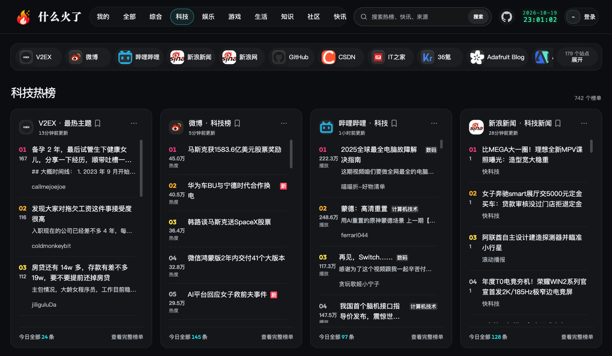

<div align="center">

# 🔥 WhatsHot · 什么火了

**一个工具，看遍全网热榜。**

微博、知乎、抖音、B 站、GitHub、财联社、周大福……<br>
把 400+ 个网站的热搜、实时快讯和金价整理成同一种格式，随取随用。

[在线体验](https://whatshot.top) · [三分钟上手](#三分钟上手) · [支持哪些网站](#支持哪些网站) · [常见问题](#常见问题) · [开发者文档](#开发者文档)

  

<a href="https://whatshot.top/tech"></a>

<sub>基于本项目构建的网页版 <a href="https://whatshot.top">whatshot.top</a></sub>

</div>

## 为什么做这个

热点散落在几十个 App 和网站里：微博看热搜，知乎看讨论，B 站看视频，财联社盯快讯，
金店官网查金价……每个都要单独打开，格式也各不相同。

WhatsHot 把它们收拢到一处。每个来源都会变成结构相同的列表，包含标题、链接、热度和时间。
你可以在终端里直接看，用 RSS 阅读器订阅，交给 AI 助手分析，也可以接进自己的产品。

> 只想看看热榜，不想安装？直接打开 **[whatshot.top](https://whatshot.top)**，网页版基于本项目构建。

## 你可以用它来

| | 场景 | 怎么做 |
| --- | --- | --- |
| 📰 | 每天花一分钟扫一遍全网热点 | 终端里输入 `whatshot weibo` |
| 📡 | 用 RSS 阅读器订阅任意榜单 | 榜单地址后加 `?rss=true` |
| 🤖 | 让 AI 帮你查热点、追事件、看趋势 | 配合 [whatshot-mcp](https://github.com/alisen39/whatshot-mcp) 接入 AI 助手 |
| 💰 | 对比各家金店今天的金价 | 周大福、周生生、老凤祥、六福等金价榜 |
| 🧩 | 做热点看板、群聊机器人、每日简报 | 调用 JSON 接口 |
| 🕰️ | 回看某个话题何时上榜、热了多久 | 开启定时采集，保存历史 |

## 三分钟上手

**1. 安装 [uv](https://docs.astral.sh/uv/)**（Python 包管理工具，会自动准备 Python 3.12+）

```bash
# macOS / Linux
curl -LsSf https://astral.sh/uv/install.sh | sh

# Windows（PowerShell）
powershell -ExecutionPolicy ByPass -c "irm https://astral.sh/uv/install.ps1 | iex"
```

**2. 下载项目**

```bash
git clone https://github.com/alisen39/whatshot.git
cd whatshot
uv sync
```

**3. 看一眼微博热搜**

```bash
uv run whatshot weibo --limit 5 -f plain
```

输出类似（示例）：

```text
1. 某地出现罕见天象
2. 新款手机今日开售
3. 周末全国大范围降温
4. 某综艺官宣新嘉宾
5. 高校食堂推出新菜品
```

换成别的网站，只需要换一个名字：

```bash
uv run whatshot zhihu -f plain        # 知乎热榜
uv run whatshot bilibili -f plain     # B 站全站排行
uv run whatshot cls -f plain          # 财联社电报
uv run whatshot --help                # 查看全部网站
```

想要别的格式，把 `-f plain` 换成 `json`、`markdown` 或 `csv`。

**4. 启动接口服务（可选）**

```bash
uv run python -m whats_hot_api
```

然后在浏览器里打开：

| 地址 | 内容 |
| --- | --- |
| <http://127.0.0.1:6688/weibo/hot> | 微博热搜（JSON） |
| <http://127.0.0.1:6688/weibo/hot?rss=true> | 同一个榜单的 RSS 订阅地址 |
| <http://127.0.0.1:6688/weibo> | 微博有哪些榜单可选 |
| <http://127.0.0.1:6688/all> | 全部网站列表 |

把 RSS 地址填进 Inoreader、Feedly、NetNewsWire、Folo 等阅读器，就能像订阅公众号一样订阅热榜。
在服务器上部署时，把 `127.0.0.1` 换成服务器地址即可。

## 支持哪些网站

目前收录 400+ 个网站、2000+ 个榜单，分为热榜、快讯、金价三类。下面只列一部分：

| 类别 | 代表来源 |
| --- | --- |
| 综合热搜 | 微博、知乎、百度、抖音、快手、今日头条、百度贴吧、豆瓣、虎扑、Google Trends |
| 视频与音乐 | 哔哩哔哩、AcFun、腾讯视频、爱奇艺、猫眼电影、网易云音乐、QQ 音乐、YouTube、TikTok、Spotify |
| 新闻 | 澎湃新闻、新华网、人民网、央视网、腾讯新闻、网易新闻、联合早报、BBC、Reuters、纽约时报 |
| 科技与开发者 | 36氪、虎嗅、少数派、IT之家、V2EX、稀土掘金、GitHub、Hacker News、Product Hunt、Stack Overflow |
| AI 与科研 | OpenAI、Anthropic、Google DeepMind、Hugging Face、arXiv、Nature、Science |
| 财经快讯 | 财联社、华尔街见闻、金十数据、东方财富、同花顺、第一财经、雪球 |
| 游戏与 ACG | Steam、NGA、米游社、原神、崩坏：星穹铁道、英雄联盟、游研社 |
| 生活与阅读 | 什么值得买、微信读书、豆瓣读书、喜马拉雅、懂球帝、中央气象台、历史上的今天 |
| 金价 | 周大福、周生生、老凤祥、六福珠宝、中国黄金、菜百首饰、周六福 |

完整清单：运行 `uv run whatshot --help`，或启动服务后访问 `/all`。

## 更多用法

### 接入 AI 助手

[whatshot-mcp](https://github.com/alisen39/whatshot-mcp) 是配套的 MCP 服务。接入 Claude、
Cursor 等支持 MCP 的 AI 工具后，可以直接问它“今天各平台都在讨论什么”“这件事最早在哪儿上的榜”。
它既可以连接你自己运行的 WhatsHot，也可以连接 WhatsHot 托管服务。

### 定时采集与历史数据

默认只返回“此刻”的榜单。如果想知道某个话题什么时候上榜、热了多久，可以启动后台采集服务，
按你设定的频率保存到本地数据库，之后再按关键词搜索、看趋势。配置方法见
[定时采集与历史数据](docs/daemon.md)。

## 常见问题

**需要注册账号或申请 API Key 吗？**
不需要。数据来自各网站公开的页面和接口，直接运行即可。

**一定要装 Redis 或数据库吗？**
不需要。没有 Redis 时自动只用内存缓存；只有开启历史采集时才会用到本地 DuckDB 文件，无需单独安装。

**数据多久更新一次？**
每次请求时实时抓取，并缓存一段时间避免频繁访问：热榜默认 30 分钟，快讯默认 5 分钟。
需要最新数据时，在地址后加 `?cache=false`，或在命令行加 `--cache refresh`。

**海外网站抓不到？**
GitHub、纽约时报等部分海外来源在国内网络需要代理，可以在 `.env` 里用 `ROUTE_PROXY` 为指定域名配置代理，
见 [HTTP API 与配置](docs/api.md#配置)。

**某个网站突然不能用了？**
网站改版很常见。欢迎提交 Issue 告诉我们，或者直接提 PR 修复。

**数据可以商用吗？**
代码使用 MIT 许可，可以自由使用。抓取到的内容版权归各来源网站所有，请遵守对方的服务条款，
并合理控制请求频率。

## 开发者文档

- [HTTP API 与配置](docs/api.md)：接口格式、查询参数、金价字段、缓存与代理配置、命令行
- [定时采集与历史数据](docs/daemon.md)：daemon、DuckDB 历史库、Backend Contract、MCP 对接
- [开发与扩展](docs/development.md)：新增网站、快讯回溯声明、作为库嵌入、测试

想新增一个网站？通常只需要在 `whats_hot_api/routes/` 下加一个文件，见
[开发与扩展](docs/development.md#新增路由)。

## License

[MIT](https://opensource.org/license/mit)。第三方代码授权说明见 [THIRD_PARTY_NOTICES.md](THIRD_PARTY_NOTICES.md)。
